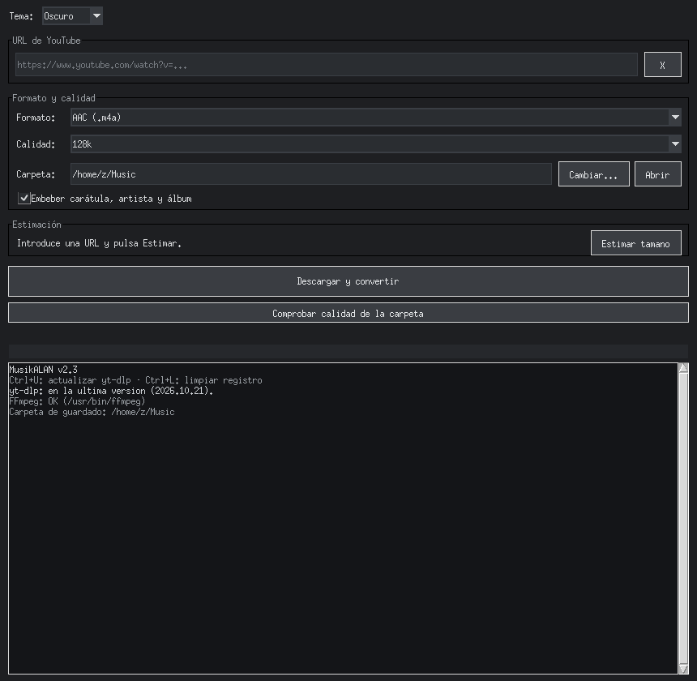

# MusikALAN — Descargador de Música para YouTube

Aplicación de escritorio para Windows que descarga música y videos de YouTube
en formatos aptos para reproductores portátiles antiguos (tipo *sheiju* MP3 de
1.8" con pantalla 128x160). Todo-in-uno: un único `DescargadorMusica.bat`
instala lo que falte **sin permisos de administrador** y abre la ventana de
descargas.



## Características

- Interfaz gráfica (Tkinter) con tema **Oscuro / Claro**
- Formatos: **AAC (.m4a) 96/128k** · **MP3 96/128/192/256/320k** · **FLAC** ·
  **WAV** · **WMA 96/128k** · **AVI (sheiju 1.8" 128x160, MJPEG 16 fps +
  PCM 22050 Hz)**
- Calidad seleccionable por formato en un desplegable
- **Playlists**: al pegar una URL con `list=` pregunta si bajar solo la
  canción o la playlist completa, con un descanso de 2 s entre canciones
- Guarda por defecto en tu carpeta **Música** de Windows, directamente y
  sin subcarpetas por formato (carpeta cambiable, se recuerda en
  `ajustes.json`)
- Casilla para embeber **carátula** (vía yt-dlp + mutagen)
- **Etiquetas completas desde la v2.4/v2.5**: título, artista (limpio, sin el
  sufijo " - Topic" de los canales de música de YouTube), álbum (el de la
  playlist si descargas una lista), año y URL escritos con mutagen en AAC/MP3/
  FLAC/WAV/WMA; la **carátula va siempre en JPEG** (las miniaturas de YouTube
  son WebP y muchos reproductores baratos solo leen JPEG — el mismo truco que
  `--convert-thumbnails jpg` del comando antiguo) y el **WMA también lleva
  carátula** (WM/Picture) y URL (WM/AuthorURL)
- **Estimación de tamaño** antes de descargar (por duración del video)
- **Comprobador de calidad de carpeta** con ffprobe: lista bitrate, duración y
  tamaño de cada archivo y marca los de bitrate bajo
- Barra de progreso con %, velocidad y tiempo restante + registro de actividad
- La URL se limpia sola cuando la descarga sale bien; si falla, se conserva
  para reintentar
- Instalación 100% portable y sin admin: Python build standalone + yt-dlp +
  mutagen + FFmpeg (espejos rápidos de GitHub: GyanD y BtbN, con gyan.dev de
  reserva) dentro de `%APPDATA%\Roaming\MusikALAN` (desde la v2.4; aunque el
  .bat esté en Descargas, y con **migración automática** de una instalación
  anterior situada junto al .bat)
- Comprobación de versión de yt-dlp contra PyPI al arrancar y actualización
  integrada (Ctrl+U)

## Uso

1. Descarga `DescargadorMusica.bat` (el archivo ya lleva el código embebido en
   base64).
2. Doble clic. La primera vez descarga Python portátil (~42 MB), yt-dlp y
   FFmpeg (~90 MB) si no los tienes. Solo necesita internet esa primera vez.
3. Pega la URL, elige formato/calidad y pulsa **Descargar y convertir**. Si la
   URL es una playlist, el programa te pregunta: **solo la canción**, la
   **playlist completa** (pausa de 2 s entre canciones) o **cancelar**.

Las descargas quedan en tu carpeta **Música** (`C:\Users\TU_USUARIO\Music`),
directamente y sin subcarpetas por formato (carpeta cambiable en la ventana).
El programa y sus componentes viven en `%APPDATA%\Roaming\MusikALAN`; si
venías de una versión anterior, el propio .bat mueve solo esa instalación
antigua a la nueva carpeta (sin volver a descargar nada).

## Formato AVI para reproductor sheiju 1.8"

El AVI usa los parámetros oficiales del repositorio
[fdd4s/portable_mp3_player_video_converter_tools](https://github.com/fdd4s/portable_mp3_player_video_converter_tools)
(script `video2shenju18.sh`):

```bash
ffmpeg -i entrada -vf "scale=-2:128, crop=160:128, transpose=2, vflip" \
       -r 16 -acodec pcm_s16le -ac 2 -ar 22050 -pix_fmt yuvj420p \
       -c:v mjpeg -q:v 2 salida.avi
```

Para videos cuadrados/verticales (Shorts) existe un modo compatible con
letterbox que se aplica automáticamente.

## Estructura del repositorio

```
├── DescargadorMusica.bat    ← entregable final (instalador + app)
├── LEEME.txt                ← manual de usuario
├── codigo_fuente/
│   ├── descargador.py       ← aplicación (Tkinter + yt-dlp + FFmpeg)
│   ├── plantilla_bat.txt    ← plantilla del instalador
│   ├── empaquetar.py        ← build: inserta descargador.py en el BAT
│   └── probar_payload.py    ← test: round-trip del payload base64
└── README.md
```

## Desarrollo

Editar la interfaz y regenerar el BAT único:

```bash
cd codigo_fuente
python empaquetar.py                 # genera ../DescargadorMusica.bat
python probar_payload.py ../DescargadorMusica.bat descargador.py
```

`empaquetar.py` codifica `descargador.py` en base64 (líneas de 64 columnas con
prefijo `:::`); el BAT lo extrae con `findstr` + `certutil -f -decode`, de modo
que el ejecutable final es un solo archivo compartible por WhatsApp/Drive/USB.

## Requisitos

- Windows 10 1803+ (32-bit, 64-bit o ARM64). No funciona en Windows 7.
- Internet solo la primera ejecución.

## Aviso

Descarga solo contenido cuyo uso te corresponda (tus propios videos, material
con licencia libre, etc.). Respeta los términos de servicio y los derechos de
autor de tu país.
